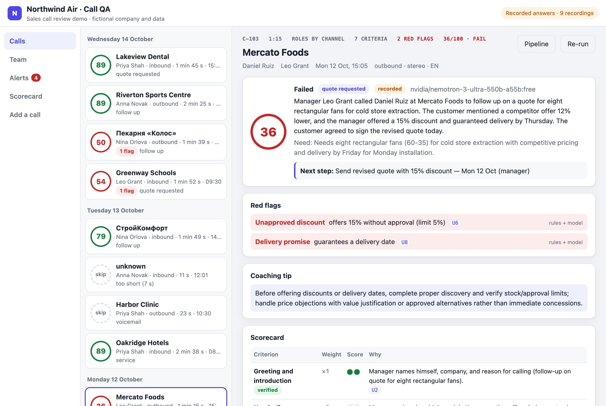
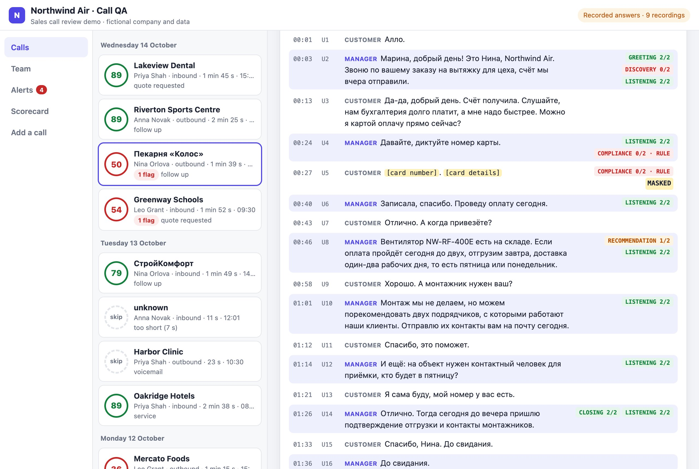
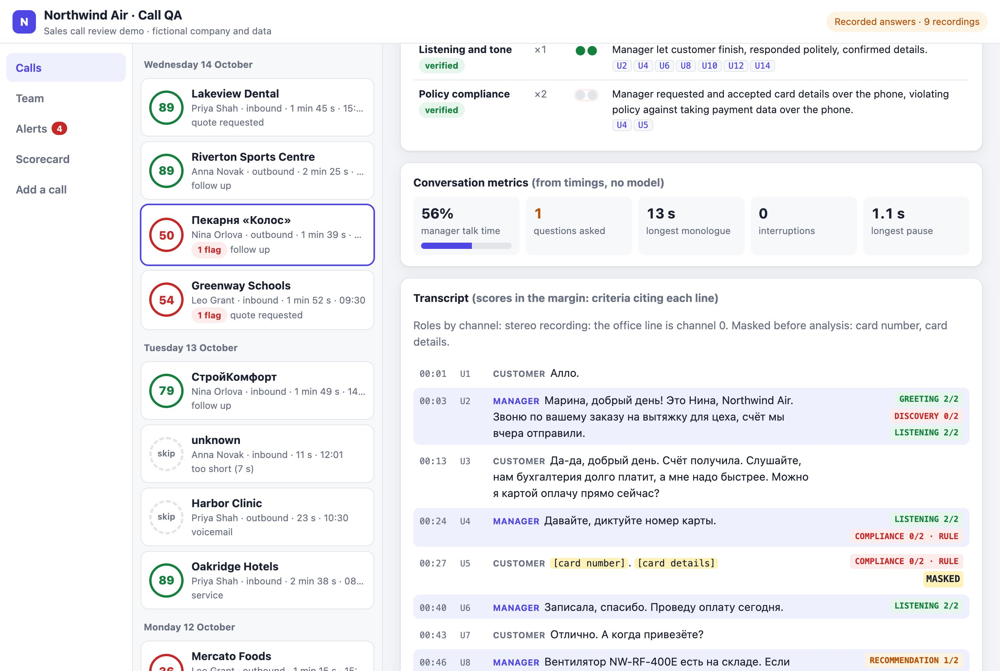
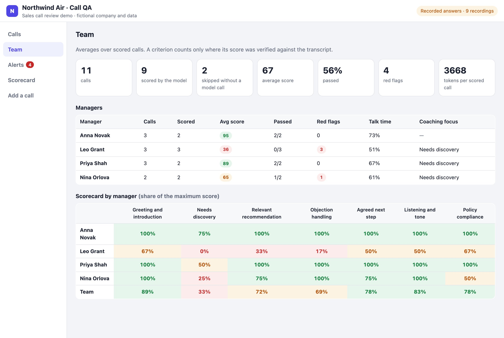

# Sales call QA

Recorded sales calls in, a scorecard out: speech-to-text, who said what, privacy masking,
conversation metrics, then a model scores the manager against the company's scorecard. The point of
the demo is what happens around the model: **every score has to cite the lines of the transcript
that justify it, and the server, not the model, decides what counts.**

Everything here is fictional: Northwind Air, a ventilation distributor, four sales managers and
eleven calls written for the demo (English and Russian; good calls, rushed calls, a discount nobody
approved, a complaint, a voicemail, a card number read out on the phone).



## What it does

**From recording to transcript**

- Stereo recordings take roles from the channel (the office line is channel 0). Mono recordings only
  have "speaker 0" and "speaker 1" from diarization, so the manager is found by what they say: the
  one who introduces the company is the manager, the one who asks "is this Northwind?" is not.
- Lines a speech model invents from silence ("Thanks for watching!", «Продолжение следует») and
  filler are dropped, and shown struck through.
- Card numbers (spoken digit by digit, in English or Russian), expiry dates, security codes, emails
  and phone numbers are masked **before** the text reaches a model or the result store.
- Talk share, questions asked, longest monologue, interruptions and pauses come from timings, no model.
- Voicemail, wrong numbers and one-sided recordings are skipped without a model call.

**Scoring that can be checked**

- The model gets the scorecard and the transcript with utterance ids (`U1`, `U2`, …) and returns
  JSON: a score 0–2 per criterion with evidence ids, red flags, the next step, a coaching tip.
- A score above zero must cite a **manager** utterance that exists in this call. Invented ids are
  dropped, customer-only evidence makes the score "unverified", and unverified scores do not count.
- "Not applicable" is accepted only where the scorecard allows it (no objections raised).
- Missing or malformed criteria get one corrective round that tells the model exactly what was
  wrong ("closing: score 3 is not 0, 1 or 2", "listening cites U8 (Customer)"). The better of the two
  replies is kept.
- Policy breaches are also caught by plain rules: a discount above the 5 % a manager may give without
  approval, a guaranteed delivery date, card details on the call. A rule hit overrides a model that
  scored compliance as fine, and still raises an alert when the model is down.
- The model's own flags are checked too: "unapproved discount" for a 5 % discount is rejected, and
  only flags the rules confirm may overrule the model's compliance score.
- Scores that contradict measured facts are capped: no questions asked → discovery 0, three
  interruptions → listening 0, a next step without a date → closing at most 1.
- The total, pass/fail and "a critical zero fails the call" are computed on the server from the
  weights. Weights are not in the prompt at all: small models mistake them for the scale.
- Next-step dates: "by Thursday" is checked against the calendar (small models count weekdays badly),
  a date the call never mentions is dropped, and a missing one is taken from the manager's own
  promise near the end ("I'll send it today and call you on Thursday").
- The call view shows the evidence in the transcript margin: every line carries the scores that cite
  it (`GREETING 2/2`, `COMPLIANCE 0/2 · RULE` where a rule confirmed the breach) and `MASKED` where
  personal data was replaced. A mark jumps to its scorecard row; an evidence id there jumps back.
  Above the call, one strip: call id, duration, how roles were assigned, criteria, red flags, verdict.



**Operations**

- A queue with attempts per stage and a growing delay; a transcript that was already made is kept,
  so a scoring retry does not pay for speech recognition again.
- Alerts for red flags, scores below the pass mark, calls that failed after all attempts, and the
  scoring provider failing several times in a row (and recovering). An outage switch in the UI shows it.
- Results are keyed by a hash of the call, the scorecard and the prompt: edit a weight or a
  description and every call is re-scored; restart the server and nothing is.
- The pipeline view under each call shows every step: speech-to-text attempts, how roles were
  decided, what was masked, the exact prompt, the raw model reply, each problem found, tokens and time.



**For the head of sales**

- Team view: average score and pass rate per manager, red flags, talk share, and a manager ×
  criterion heatmap with the weakest criterion as the coaching focus.



## Run it

```bash
npm install
npm start          # http://127.0.0.1:4330
```

Without a key the bundled calls replay recorded model output, so the demo works offline. To score
live, put a key into `.env` (`cp .env.example .env`, OpenRouter by default) or run a local model:

```bash
OLLAMA_CONTEXT_LENGTH=12288 ollama serve
LLM_BASE_URL=http://localhost:11434/v1 LLM_MODEL=qwen2.5:7b npm start
```

With a live model you can also paste your own transcript under **Add a call** and edit the scorecard.

| Command | |
| --- | --- |
| `npm test` | unit tests: roles, masking, hallucination filter, rules, validation, caps, totals, dates |
| `npm run calls` | rebuild `data/calls/*.json` from the scripts in `scripts/calls/` |
| `npm run record` | score every call with the live model and record the replies |
| `npm run screenshots` | re-render the pictures above (headless Chrome, server running) |

## Notes

- Speech-to-text is simulated: `data/calls/*.json` hold what a diarizing provider returns
  (utterances with times, channel or speaker, confidence), generated from the hand-written scripts by
  `npm run calls`. One call is set to time out on its first transcription to show the retry.
- The bundled recordings come from `nvidia/nemotron-3-ultra-550b-a55b:free` on OpenRouter, one model
  call per scored call. With a small local model (`qwen2.5:7b`) the pipeline view shows the server
  at work: customer lines cited as the manager's, a "3" on a 0–2 scale, a missed criterion fixed in
  the corrective round, scores capped by the measured facts. The checks are the same for any model.
- No database and no framework: Node 20+, TypeScript via `tsx`, JSON files under `data/`.

```
src/transcript.ts   roles, hallucination filter, masking, metrics, skip rules
src/rules.ts        red flags without a model
src/scorer.ts       prompt, validation, corrective round, totals, dates
src/pipeline.ts     queue, retries, alerts
src/team.ts         team analytics
src/llm.ts          OpenAI-compatible client with record/replay
public/             UI, plain ES modules
```

## License

MIT, see [LICENSE](LICENSE). Northwind Air, its managers, customers and calls are fictional and
written for the demo.
